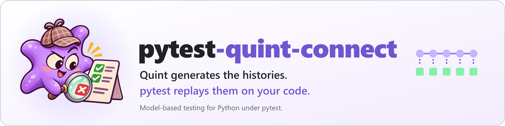
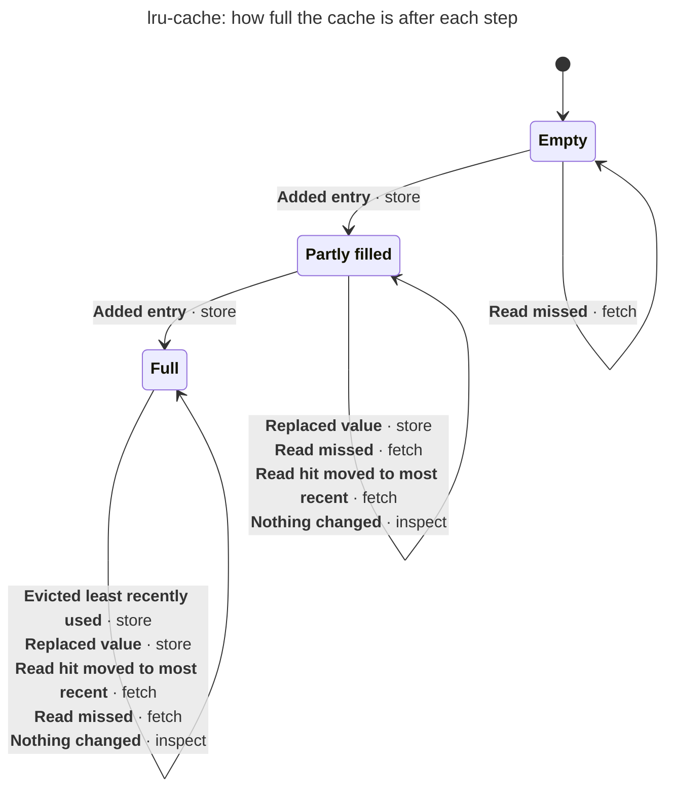
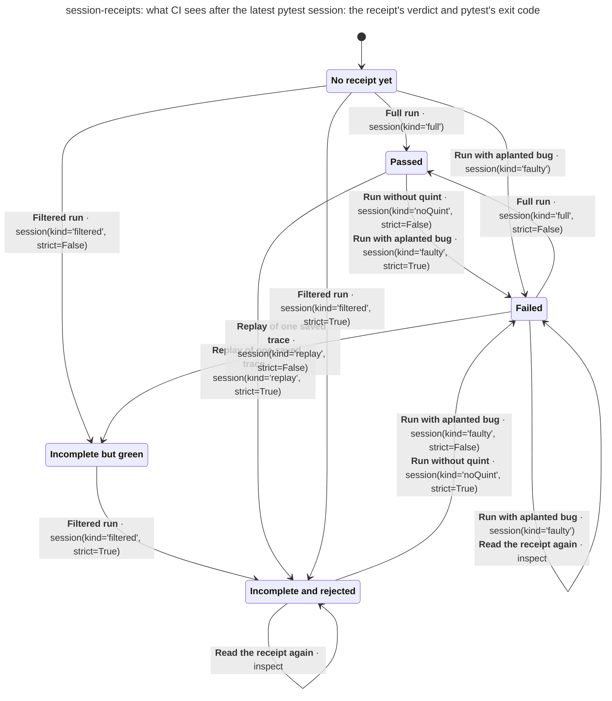
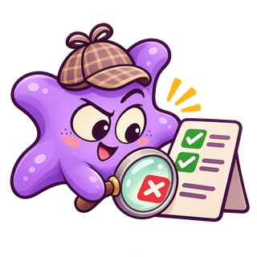

<p align="center"><picture>
  <source media="(prefers-color-scheme: dark)" srcset="https://raw.githubusercontent.com/gigaverse-app/pytest-quint-connect/main/docs/assets/readme-hero-dark.png?v=fbbc73f6a0f1">
  
</picture></p>

# pytest-quint-connect

[](https://pypi.org/project/pytest-quint-connect/)
[](https://github.com/gigaverse-app/pytest-quint-connect/actions/workflows/ci.yml)
[](pyproject.toml)
[](https://quint.sh)
[](src/pytest_quint_connect/py.typed)
[](LICENSE)
[](skills/pytest-quint-connect/SKILL.md)
[](https://pytest-quint-connect.readthedocs.io/en/latest/)

**Model-based testing for Python under pytest.** Write the rules of a stateful API
once, as a small [Quint](https://quint.sh) model. pytest-quint-connect replays the
histories Quint generates from it against your real code, and fails when the code
disagrees.

### Set it up with your coding agent

Paste this into Claude Code, Codex, Cursor or another coding agent, in your repository:

```text
Add pytest-quint-connect to this repository. Fetch https://pytest-quint-connect.readthedocs.io/en/latest/agent-setup.md and follow it.
```

The agent picks one part of your code that keeps state, writes its rules down as a
short model, connects the model to the code, adds deliberate bugs the check must
catch, adds a CI job, and reports what it verified. **You review the model.** It is
the specification. An agent can write a wrong model, which then checks the wrong
rules, so read it before you merge. The tests themselves run without AI, in CI, on
every change. This is the split Quint's authors describe in
[Reliable Software in the LLM Era](https://quint.sh/posts/llm_era) and
[Quint Connect](https://quint.sh/posts/quint_connect). To do it by hand, follow the
[tutorial](docs/tutorial.md).

### In plain words

- **Model**: a short Quint file that says what your API should do: its operations,
  and what you should be able to read back after each one.
- **History**: a sequence of operations generated from the model, with the expected
  state after each step. Some are scenarios you name; the rest are sampled from a fixed seed.
- **Driver**: a few lines of Python that apply each step to your real code and read
  its state back. It never computes the answer.
- **Mutant**: a deliberately broken version of your code. Every run must catch it,
  which proves the check can fail.

Hand-written tests check the cases someone thought of, and a change can rewrite them
along with the code. A contract checks every generated history against rules kept
apart from the code. So a change by a person or a coding agent is judged against the
rules, not against tests the same change may have edited.
[Why, with real output](docs/why.md) · [Tutorial](docs/tutorial.md) ·
[Run it in CI](docs/ci.md)

[Read the documentation](https://pytest-quint-connect.readthedocs.io/en/latest/) · [Related tools](https://pytest-quint-connect.readthedocs.io/en/latest/ecosystem/)

This is a community Python integration in the spirit of
[Quint Connect](https://github.com/quint-co/quint-connect) (Rust) and
[Quint's model-based testing guide](https://quint.sh/docs/model-based-testing).
It is not an official Quint project and is not endorsed by its maintainers.

```text
test_lru_contract.py::test_lru_cache[witness-evictsLeastRecentlyUsedTest] FAILED

Quint contract 'lru-cache': implementation state differs from the model
  trace:  .artifacts/quint-connect/lru-cache/witness-evictsLeastRecentlyUsedTest-0.itf.json
  state:  3 after action fetch(key='a')
  seed:   7
  4 difference(s):
  entries[0].key: values differ
      expected: 'b'
      actual:   'a'
  ...
  reproduce: pytest test_lru_contract.py::test_lru_cache --quint-replay .artifacts/quint-connect/lru-cache/witness-evictsLeastRecentlyUsedTest-0.itf.json
```

## Quick start

Install the plugin, plus Node.js 22+ with npm. On first use the plugin installs its
locked Quint 0.33.1 into a per-user cache. To use your own Quint, pass `--quint PATH`
or set `QUINT`.

```bash
pip install pytest-quint-connect
```

To try unreleased changes, install from Git instead:
`pip install "pytest-quint-connect @ git+https://github.com/gigaverse-app/pytest-quint-connect"`.

Generate a typed driver base from the model, then declare the contract:

```bash
pytest-quint-connect codegen quint-connect.json  # writes lru_cache_driver.py
```

```python
# test_cache_contract.py
from pytest_quint_connect import quint_contract

test_cache = quint_contract("quint-connect.json", driver="cache_driver")
```

Subclass the generated base. It has one typed method per model action and an
`observe()` typed as the model's observed state, so a type checker flags a driver
that has drifted from the spec:

```python
# conftest.py
import pytest
from lru_cache_driver import LruCacheDriver, Read, View  # generated
from my_cache import LRUCache


class CacheDriver(LruCacheDriver):
    def __init__(self) -> None:
        self.cache, self.last = LRUCache(2), {"tag": "NoRead"}

    def init(self) -> None: ...
    def inspect(self) -> None: ...

    def store(self, key: str, value: int) -> None:  # apply one model action to the real code
        self.cache.put(key, value)

    def fetch(self, key: str) -> None:
        value = self.cache.get(key)
        self.last: Read = {"tag": "Miss"} if value is None else {"tag": "Hit", "value": value}

    def observe(self) -> View:  # read the real state back
        return {"entries": [{"key": k, "value": v} for k, v in self.cache.items()], "lastRead": self.last}


@pytest.fixture
def cache_driver():
    return lambda context: CacheDriver()  # called once per history: fresh state each time
```

```bash
pytest --quint-require-complete
```

In CI, add the report as the next step. It keeps one comment on each pull request
with what ran, what failed and the command that reproduces each failure, and keeps a
README block like [this repository's](#measured) current:

```yaml
- run: pytest --quint-require-complete
- uses: gigaverse-app/pytest-quint-connect/report@v1  # job permission: pull-requests: write
  if: ${{ !cancelled() }}
```

A hand-written driver that implements `step(step)` and `observe()` works too; see
[drivers](docs/drivers.md).

[examples/lru_cache](examples/lru_cache) is the complete version. It checks a
list-based cache and an `OrderedDict` refactor against the same generated
histories, catches a cache whose reads forget to refresh recency, and runs from
the installed wheel in CI.

## What a contract run does

```text
quint-connect.json ──► quint typecheck ──► quint test  (named witnesses)  ──► witness-*.itf.json ─┐
                                      └──► quint run --mbt (seeded samples) ──► sample-*.itf.json  ─┤
                                                                                                 ▼
pytest: test_x[witness-…] test_x[sample-N] ──► fresh driver per history ──► step → observe → compare
        test_x[mutant-…]   every trace through the mutant; only an observed mismatch counts
        test_x[coverage]   every declared action reached
                                                                                                 ▼
                     .artifacts/quint-connect/results.json, traces, logs, mismatch-*.json
```

- **Real pytest cases.** Each witness, sample, mutant and the coverage check is a
  parametrized case: selectable with `-k`, listed by `--collect-only`, reported in
  JUnit (with `quint_trace`, `quint_seed` and `quint_detected_by` properties),
  with ordinary fixture setup and teardown.
- **Fresh Quint, every run.** Traces are regenerated from the model with the
  manifest's seed and bounds; the output directory is emptied first. Collection
  never runs Quint; a Quint failure is a setup error for every case of that contract.
- **Mutation controls.** A mutant passes only when some generated history produces
  an observed-state mismatch. An exception while building or running the mutant fails
  the case: it is not detection. Mutants are planted fake bugs that prove the tests are
  meaningful. Bugs a contract found and that were fixed (`bugs_found`) lead the report; a
  mutant that reintroduces one is replayed through every history, and the report says how many diverge.
- **Complete or not.** With `--quint-require-complete`, the session fails unless every
  contract in `quint_required_contracts` ran every case and passed. A `-k`-filtered run
  is recorded as `partial`, a replay as `replay-only`; a crash leaves `running`, never
  an earlier `passed`.
- **Actionable failures.** A mismatch names the trace, state, action and arguments,
  a field-level expected/actual difference, the seed and a command that replays that
  exact trace (`--quint-replay`, optionally `--quint-mutant`). An exception from the
  driver keeps its own type and message and gains the same location as a note.

## To / Read

| To | Read |
| --- | --- |
| See why, with real output | [docs/why.md](docs/why.md) |
| Build your first contract step by step | [docs/tutorial.md](docs/tutorial.md) |
| Make contracts a required CI check | [docs/ci.md](docs/ci.md) |
| Set it up with a coding agent | [the agent setup procedure](skills/pytest-quint-connect/SKILL.md), also served raw at [agent-setup.md](https://pytest-quint-connect.readthedocs.io/en/latest/agent-setup.md) |
| Write a manifest | [docs/manifest.md](docs/manifest.md) |
| Write a driver and choose a step convention | [docs/drivers.md](docs/drivers.md) |
| Know what a passing run does and does not prove | [docs/limits.md](docs/limits.md) |
| Configure options and read the receipt | [docs/reference.md](docs/reference.md) |
| See it on production integrations | [pytest-obligation's report-merge contract](https://github.com/gigaverse-app/pytest-obligation/tree/main/docs/quint/report-merge), [pytest-selective's selection contract](https://github.com/gigaverse-app/pytest-selective/tree/main/contracts/selection), [dry-lint's campaign ledger contract](https://github.com/gigaverse-app/dry-lint/tree/main/contracts/campaign) |

## Measured

This repository's own contract, from the receipt of its last complete CI run. The block is
generated, and CI fails when it no longer matches the evidence:

<!-- pytest-quint-connect:start -->
<!-- pytest-quint-connect:contracts lru-cache,session-receipts -->
<!-- pytest-quint-connect:evidence e0246d36c8e1ade4 renderer 1.4.0 -->
<a href="https://github.com/gigaverse-app/pytest-quint-connect#impact"><picture><source media="(prefers-color-scheme: dark)" srcset="https://pytest-quint-connect-counter.gigaverse-oss.workers.dev/v1/sign.svg?key=bc47fb5de1a72359c95c190667ac9a84218d2ce822909a59d7e114ff2779542f&amp;name=gigaverse-app%2Fpytest-quint-connect&amp;theme=dark"></picture></a>

<a href="https://github.com/gigaverse-app/pytest-quint-connect" title="Mutants are planted fake bugs: deliberately broken copies of the code, used only during this test run. Each must make some history diverge, proving the tests are meaningful: they would notice that kind of bug"></a>

<details>
<summary>✅ 2 contracts · 47/47 cases · 6/6 mutants caught · 23 histories</summary>

| | Contract | Cases passed | [Mutants caught](https://github.com/gigaverse-app/pytest-quint-connect/blob/v1.4.0/docs/why.md#proof-that-the-tests-can-fail "Mutants are planted fake bugs: deliberately broken copies of the code, used only during this test run. Each must make some history diverge, proving the tests are meaningful: they would notice that kind of bug") |
| :-: | :-- | --: | --: |
| ✅ | `lru-cache` `test_lru_contract.py::test_lru_cache`<br><sub>15 histories (3 witnesses, 12 samples, seed 7) · every action covered · Quint 0.33.1</sub> | 17/17 | 1/1 |
| ✅ | `lru-cache` `test_lru_contract.py::test_ordered_refactor`<br><sub>15 histories (3 witnesses, 12 samples, seed 7) · every action covered · Quint 0.33.1</sub> | 17/17 | 1/1 |
| ✅ | `session-receipts` `test_session_contract.py::test_session_receipts`<br><sub>8 histories (4 witnesses, 4 samples, seed 11) · every action covered · Quint 0.33.1</sub> | 13/13 | 4/4 |

</details>

<details>
<summary>🐞 1 real bug found by these contracts</summary>

| Contract | Bug | Fixed in | Regression test |
| :-- | :-- | :-- | :-- |
| `session-receipts` | Valid histories whose step calls one action without any { … } were rejected: Quint records mbt::actionTaken as step, and the event cross-check refused it<br><sub>found by the first run of this contract · no mutant re-checks it</sub> | #3 | <sub>`tests/test_replay.py`<br>`::test_unbranched_step_is_recorded_under_the_step_name_and_still_replays`</sub> |

</details>

<details>
<summary>🧪 5 mutants (planted fake bugs), all caught</summary>

| Contract | [Mutant](https://github.com/gigaverse-app/pytest-quint-connect/blob/v1.4.0/docs/why.md#proof-that-the-tests-can-fail "Mutants are planted fake bugs: deliberately broken copies of the code, used only during this test run. Each must make some history diverge, proving the tests are meaningful: they would notice that kind of bug") | What it breaks | Caught by | At |
| :-- | :-- | :-- | :-- | :-- |
| `lru-cache` | `stale-read` | get() returns the value but does not refresh recency, so a just-read entry can be evicted next | `witness-evictsLeastRecentlyUsedTest`<br><sub>samples: 3/12 diverge</sub> | state 3, after `fetch(key='a')` |
| `session-receipts` | `filtered-counts-as-complete` | a -k run that skipped cases is judged as if every case ran | `witness-filteredRunIsNeverPassedTest`<br><sub>samples: 1/4 diverge</sub> | state 1, after `session(kind='filtered', strict=False)` |
| `session-receipts` | `replay-counts-as-complete` | replaying one saved trace no longer marks the session incomplete | `witness-replayIsNeverCompleteTest`<br><sub>samples: 2/4 diverge</sub> | state 2, after `session(kind='replay', strict=True)` |
| `session-receipts` | `failed-session-keeps-old-receipt` | a failed or still-running session leaves the previous results.json in place | `witness-staleSuccessIsReplacedTest`<br><sub>samples: 4/4 diverge</sub> | state 2, after `session(kind='noQuint', strict=False)` |
| `session-receipts` | `require-complete-ignored` | --quint-require-complete is accepted but never changes the exit code | `witness-filteredRunIsNeverPassedTest`<br><sub>samples: 2/4 diverge</sub> | state 2, after `session(kind='filtered', strict=True)` |

</details>

<details open>
<summary>What <code>lru-cache</code> says</summary>

**How `lru-cache` behaves**. **Boxes:** how full the cache is after each step (variable `fill`). **Arrows:** what each step did to the cache (variable `change`), in bold, then the action that did it. Merged from the 15 histories Quint generated; a state or step none of them reached is not drawn. [Open full size ↗](https://mermaid.live/view#base64:eyJjb2RlIjoiLS0tXG50aXRsZTogXCJscnUtY2FjaGU6IGhvdyBmdWxsIHRoZSBjYWNoZSBpcyBhZnRlciBlYWNoIHN0ZXBcIlxuLS0tXG5zdGF0ZURpYWdyYW0tdjJcbiAgc3RhdGUgXCI8Yj5FbXB0eTwvYj5cIiBhcyBzMFxuICBzdGF0ZSBcIjxiPlBhcnRseSBmaWxsZWQ8L2I-XCIgYXMgczFcbiAgc3RhdGUgXCI8Yj5GdWxsPC9iPlwiIGFzIHMyXG4gIFsqXSAtLT4gczBcbiAgczAgLS0-IHMxIDogPGI-QWRkZWQgZW50cnk8L2I-ICMxODM7IHN0b3JlXG4gIHMxIC0tPiBzMiA6IDxiPkFkZGVkIGVudHJ5PC9iPiAjMTgzOyBzdG9yZVxuICBzMiAtLT4gczIgOiA8Yj5FdmljdGVkIGxlYXN0IHJlY2VudGx5IHVzZWQ8L2I-ICMxODM7IHN0b3JlPGJyPjxiPlJlcGxhY2VkIHZhbHVlPC9iPiAjMTgzOyBzdG9yZTxicj48Yj5SZWFkIGhpdCBtb3ZlZCB0byBtb3N0IHJlY2VudDwvYj4gIzE4MzsgZmV0Y2g8YnI-PGI-UmVhZCBtaXNzZWQ8L2I-ICMxODM7IGZldGNoPGJyPjxiPk5vdGhpbmcgY2hhbmdlZDwvYj4gIzE4MzsgaW5zcGVjdFxuICBzMSAtLT4gczEgOiA8Yj5SZXBsYWNlZCB2YWx1ZTwvYj4gIzE4Mzsgc3RvcmU8YnI-PGI-UmVhZCBtaXNzZWQ8L2I-ICMxODM7IGZldGNoPGJyPjxiPlJlYWQgaGl0IG1vdmVkIHRvIG1vc3QgcmVjZW50PC9iPiAjMTgzOyBmZXRjaDxicj48Yj5Ob3RoaW5nIGNoYW5nZWQ8L2I-ICMxODM7IGluc3BlY3RcbiAgczAgLS0-IHMwIDogPGI-UmVhZCBtaXNzZWQ8L2I-ICMxODM7IGZldGNoIiwibWVybWFpZCI6IntcInRoZW1lXCI6IFwiZGVmYXVsdFwifSJ9)



**Actions**, and the code each one drives:

- `init`: construct a fresh cache with capacity 2
- `store`: cache.put(key, value)
- `fetch`: cache.get(key), observed as Hit(value) or Miss
- `inspect`: read cache.items() without changing it

**Invariant** `withinCapacity`, checked while sampling histories.

**Witnesses**, scenarios replayed exactly as written: `evictsLeastRecentlyUsedTest`, `overwriteRefreshesTest`, `missKeepsContentsTest`.

**Bounds**: seed `7` · max_samples `200` · max_steps `8` · n_traces `12`.

<details>
<summary>Scenario: Evicts least recently used, step by step</summary>

**Witness `evictsLeastRecentlyUsedTest`, step by step**: the observation the model starts from, then what it expects each action to change.

| State | Action | Model expects |
| --: | :-- | :-- |
| `0` | `init()` | `{ entries: [], lastRead: NoRead }` |
| `1` | `store(key='a', value=1)` | `entries: [] → [{ key: "a", value: 1 }]` |
| `2` | `store(key='b', value=2)` | `entries: [{ key: "a", value: 1 }] → [{ key: "a", value: 1 }, { key: "b", value: 2 }]` |
| `3` | `fetch(key='a')` | `entries: [{ key: "a", value: 1 }, { key: "b", value: 2 }] → [{ key: "b", value: 2 }, { key: "a", value: 1 }]`<br>`lastRead: NoRead → Hit(1)` |
| `4` | `store(key='c', value=0)` | `entries: [{ key: "b", value: 2 }, { key: "a", value: 1 }] → [{ key: "a", value: 1 }, { key: "c", value: 0 }]`<br>`lastRead: Hit(1) → NoRead` |
| `5` | `inspect()` | unchanged |

</details>

</details>

<details open>
<summary>What <code>session-receipts</code> says</summary>

**How `session-receipts` behaves**. **Boxes:** what CI sees after the latest pytest session: the receipt's verdict and pytest's exit code (variable `stage`). **Arrows:** which pytest session ran (variable `ran`), in bold, then the action that did it. Merged from the 8 histories Quint generated; a state or step none of them reached is not drawn. [Open full size ↗](https://mermaid.live/view#base64:eyJjb2RlIjoiLS0tXG50aXRsZTogXCJzZXNzaW9uLXJlY2VpcHRzOiB3aGF0IENJIHNlZXMgYWZ0ZXIgdGhlIGxhdGVzdCBweXRlc3Qgc2Vzc2lvbjogdGhlIHJlY2VpcHQncyB2ZXJkaWN0IGFuZCBweXRlc3QncyBleGl0IGNvZGVcIlxuLS0tXG5zdGF0ZURpYWdyYW0tdjJcbiAgc3RhdGUgXCI8Yj5ObyByZWNlaXB0IHlldDwvYj5cIiBhcyBzMFxuICBzdGF0ZSBcIjxiPlBhc3NlZDwvYj5cIiBhcyBzMVxuICBzdGF0ZSBcIjxiPkZhaWxlZDwvYj5cIiBhcyBzMlxuICBzdGF0ZSBcIjxiPkluY29tcGxldGUgYnV0IGdyZWVuPC9iPlwiIGFzIHMzXG4gIHN0YXRlIFwiPGI-SW5jb21wbGV0ZSBhbmQgcmVqZWN0ZWQ8L2I-XCIgYXMgczRcbiAgWypdIC0tPiBzMFxuICBzMCAtLT4gczEgOiA8Yj5GdWxsIHJ1bjwvYj4gIzE4Mzsgc2Vzc2lvbihraW5kPSdmdWxsJylcbiAgczEgLS0-IHMyIDogPGI-UnVuIHdpdGhvdXQgcXVpbnQ8L2I-ICMxODM7IHNlc3Npb24oa2luZD0nbm9RdWludCcsIHN0cmljdD1GYWxzZSk8YnI-PGI-UnVuIHdpdGggYXBsYW50ZWQgYnVnPC9iPiAjMTgzOyBzZXNzaW9uKGtpbmQ9J2ZhdWx0eScsIHN0cmljdD1UcnVlKVxuICBzMiAtLT4gczIgOiA8Yj5SdW4gd2l0aCBhcGxhbnRlZCBidWc8L2I-ICMxODM7IHNlc3Npb24oa2luZD0nZmF1bHR5Jyk8YnI-PGI-UmVhZCB0aGUgcmVjZWlwdCBhZ2FpbjwvYj4gIzE4MzsgaW5zcGVjdFxuICBzMCAtLT4gczMgOiA8Yj5GaWx0ZXJlZCBydW48L2I-ICMxODM7IHNlc3Npb24oa2luZD0nZmlsdGVyZWQnLCBzdHJpY3Q9RmFsc2UpXG4gIHMzIC0tPiBzNCA6IDxiPkZpbHRlcmVkIHJ1bjwvYj4gIzE4Mzsgc2Vzc2lvbihraW5kPSdmaWx0ZXJlZCcsIHN0cmljdD1UcnVlKVxuICBzNCAtLT4gczQgOiA8Yj5SZWFkIHRoZSByZWNlaXB0IGFnYWluPC9iPiAjMTgzOyBpbnNwZWN0XG4gIHMxIC0tPiBzNCA6IDxiPlJlcGxheSBvZiBvbmUgc2F2ZWQgdHJhY2U8L2I-ICMxODM7IHNlc3Npb24oa2luZD0ncmVwbGF5Jywgc3RyaWN0PVRydWUpXG4gIHMwIC0tPiBzMiA6IDxiPlJ1biB3aXRoIGFwbGFudGVkIGJ1ZzwvYj4gIzE4Mzsgc2Vzc2lvbihraW5kPSdmYXVsdHknKVxuICBzMiAtLT4gczMgOiA8Yj5SZXBsYXkgb2Ygb25lIHNhdmVkIHRyYWNlPC9iPiAjMTgzOyBzZXNzaW9uKGtpbmQ9J3JlcGxheScsIHN0cmljdD1GYWxzZSlcbiAgczAgLS0-IHM0IDogPGI-RmlsdGVyZWQgcnVuPC9iPiAjMTgzOyBzZXNzaW9uKGtpbmQ9J2ZpbHRlcmVkJywgc3RyaWN0PVRydWUpXG4gIHM0IC0tPiBzMiA6IDxiPlJ1biB3aXRoIGFwbGFudGVkIGJ1ZzwvYj4gIzE4Mzsgc2Vzc2lvbihraW5kPSdmYXVsdHknLCBzdHJpY3Q9RmFsc2UpPGJyPjxiPlJ1biB3aXRob3V0IHF1aW50PC9iPiAjMTgzOyBzZXNzaW9uKGtpbmQ9J25vUXVpbnQnLCBzdHJpY3Q9VHJ1ZSlcbiAgczIgLS0-IHMxIDogPGI-RnVsbCBydW48L2I-ICMxODM7IHNlc3Npb24oa2luZD0nZnVsbCcsIHN0cmljdD1GYWxzZSkiLCJtZXJtYWlkIjoie1widGhlbWVcIjogXCJkZWZhdWx0XCJ9In0=)



**Actions**, and the code each one drives:

- `init`: copy examples/lru_cache into a fresh project directory; no receipt yet
- `session`: run `python -m pytest` in the project with the installed plugin and the options for this kind; read results.json and the exit code
- `inspect`: read results.json and the last exit code without running anything

**Invariant** `honest`, checked while sampling histories.

**Witnesses**, scenarios replayed exactly as written: `staleSuccessIsReplacedTest`, `filteredRunIsNeverPassedTest`, `replayIsNeverCompleteTest`, `faultAfterSuccessFailsTest`.

**Bounds**: seed `11` · max_samples `300` · max_steps `3` · n_traces `4`.

<details>
<summary>Scenario: Stale success is replaced, step by step</summary>

**Witness `staleSuccessIsReplacedTest`, step by step**: the observation the model starts from, then what it expects each action to change.

| State | Action | Model expects |
| --: | :-- | :-- |
| `0` | `init()` | `{ exitCode: -1, mode: "none", status: "none" }` |
| `1` | `session(kind='full', strict=True)` | `exitCode: -1 → 0`<br>`mode: "none" → "generate-and-replay"`<br>`status: "none" → "passed"` |
| `2` | `session(kind='noQuint', strict=False)` | `exitCode: 0 → 1`<br>`status: "passed" → "failed"` |
| `3` | `inspect()` | unchanged |

</details>

</details>

<sub>Generated by [pytest-quint-connect](https://github.com/gigaverse-app/pytest-quint-connect) from contract receipts; [what a passing run proves](https://github.com/gigaverse-app/pytest-quint-connect/blob/v1.4.0/docs/limits.md).</sub>
<!-- pytest-quint-connect:end -->

[`session-receipts`](dogfood) checks the plugin itself: each step is a real pytest session of
the example, and the planted bugs break the plugin's own completeness and receipt logic. CI also
runs [`lru-cache`](examples/lru_cache), the teaching example, as a smoke test (the list and
`OrderedDict` implementations pass the same histories, and the stale-read cache fails 4 of 15);
it is not reported here, because it checks tutorial code, not code this repository ships.

Adopters measure their own contracts the same way; these figures come from their CI:

| Contract | Histories | Cases | Planted bugs (mutants) detected | Notes |
| --- | --- | --- | --- | --- |
| pytest-obligation `merge_reports` | 21 (5 witnesses, 16 samples) | 28 | 6/6 | same 21 histories, state for state, as the runner it replaced |
| [pytest-selective's selection](https://github.com/gigaverse-app/pytest-selective/tree/main/contracts/selection) | 19 (7 witnesses, 12 samples) | 23 | 3/3 | each step is a real Git commit selected by `affected()`; the mutants drop base-tree edges, stop after direct importers and ignore global inputs |
| [dry-lint's campaign ledger](https://github.com/gigaverse-app/dry-lint/tree/main/contracts/campaign) | 20 (4 witnesses, 16 samples) | 25 | 4/4 | each step drives the real `CampaignStore` on a SQLite ledger; found a real bug (a reservation could be settled twice, refunding credit again) |

Quint 0.33.1, TypeScript backend. See [PROVENANCE.md](PROVENANCE.md) for where the
engine came from and how the baseline was reproduced.

### Duplicates kept out

Local hooks and the required PR check prevent new copies. The weekly audit
records progress against the accepted backlog. [Setup and cleanup workflow](CONTRIBUTING.md#duplication).

<!-- dry-lint-progress:start -->
<a href="https://github.com/gigaverse-app/dry-lint"><picture><source media="(prefers-color-scheme: dark)" srcset="https://dry-lint-counter.gigaverse-oss.workers.dev/v1/sign.svg?theme=dark&amp;key=bc47fb5de1a72359c95c190667ac9a84218d2ce822909a59d7e114ff2779542f&amp;name=gigaverse-app%2Fpytest-quint-connect&amp;cleaned=0&amp;remaining=5&amp;dismissed=0"></picture></a>

**Reviewed duplication debt** · Counts from the committed baselines.

| Accepted pairs | Remaining | Retired | Dismissed |
| :-- | --: | --: | --: |
| Functions | 5 | 0 | 0 |
| Models | Not initialized | — | — |

[Accepted backlog](.dry-lint/baseline.json) · [Weekly audit](https://github.com/gigaverse-app/pytest-quint-connect/actions/workflows/dry-lint-audit.yml)

Retired means a side was removed, or (functions only) the judge now finds the pair separate. It is not a count of refactors. Dismissals stay separate; an uninitialized model baseline is unknown.
<!-- dry-lint-progress:end -->

## Impact

<a href="https://pytest-quint-connect-counter.gigaverse-oss.workers.dev/v1/sign.svg"><picture>
<source media="(prefers-color-scheme: dark)" srcset="https://pytest-quint-connect-counter.gigaverse-oss.workers.dev/v1/sign.svg?theme=dark">

</picture></a>

Every repository whose report action shares its totals adds its merged pull requests here: the disagreements its
contracts caught between the code and its Quint model, and how many were fixed before merge. Repositories are
counted pseudonymously, and `share-totals: "false"` opts out ([what is sent](docs/reference.md#the-global-counter)).

## Meet Quinty

<p>



</p>

Quinty is a starfish: five arms, a *quint*. On a pull request, Quinty stamps approval when every
history matched the model, follows the map to the spot where the code left the model when one did
not, and otherwise inspects the contract.

## Related projects

| Project | What it does |
| --- | --- |
| [pytest-obligation](https://github.com/gigaverse-app/pytest-obligation) | Conformance proofs for background work that must survive lost messages and dead workers |
| [Due](https://github.com/gigaverse-app/due) | Durable obligations for Python: PostgreSQL remembers what is owed |
| [pytest-selective](https://github.com/gigaverse-app/pytest-selective) | Explainable test impact analysis for pytest |
| [CI-esta](https://github.com/gigaverse-app/ci-esta) | CI observability and honest merge gates |
| [dry-lint](https://github.com/gigaverse-app/dry-lint) | Finds code that re-implements what the codebase already does |

## License

Apache 2.0. See [CONTRIBUTING.md](CONTRIBUTING.md) to work on pytest-quint-connect
itself and [RELEASING.md](RELEASING.md) for publishing.

---

[](https://github.com/gigaverse-app/ci-esta)

[](https://github.com/gigaverse-app/pytest-selective)

<sub>Pull requests run only the [test lanes](.github/test-lanes.json) and test files a
change can affect, chosen by [pytest-selective](https://github.com/gigaverse-app/pytest-selective).
[CI-esta](https://github.com/gigaverse-app/ci-esta) reports this repository's CI timing,
keeps its test durations and owns its required gate. Neither is a dependency of
pytest-quint-connect. See [how CI runs here](docs/ci-toolkit.md).</sub>
