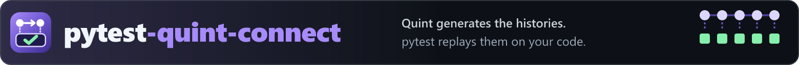

# pytest-quint-connect

[](https://github.com/gigaverse-app/pytest-quint-connect/actions/workflows/ci.yml)
[](pyproject.toml)
[](https://quint.sh)
[](src/pytest_quint_connect/py.typed)
[](LICENSE)
[](skills/pytest-quint-connect/SKILL.md)
[](https://pytest-quint-connect.readthedocs.io/en/latest/)

**Model-based testing for Python under pytest.** [Quint](https://quint.sh)
generates histories from your specification; pytest-quint-connect replays every
step against your real Python implementation and compares the state you read back
with the state the model expects.

[Read the documentation](https://pytest-quint-connect.readthedocs.io/en/latest/) · [Related tools](https://pytest-quint-connect.readthedocs.io/en/latest/ecosystem/)

This is a community Python integration in the spirit of
[Quint Connect](https://github.com/quint-co/quint-connect) (Rust) and
[Quint's model-based testing guide](https://quint.sh/docs/model-based-testing).
It is not an official Quint project and is not endorsed by its maintainers.

```text
test_lru_contract.py::test_lru_cache[witness-evictsLeastRecentlyUsedTest] FAILED

Quint contract 'lru-cache': implementation state differs from the model
  trace:  .artifacts/quint-connect/lru-cache/witness-evictsLeastRecentlyUsedTest-0.itf.json
  state:  3 after action fetch(key='a', value=0)
  seed:   7
  4 difference(s):
  entries[0].key: values differ
      expected: 'b'
      actual:   'a'
  ...
  reproduce: pytest test_lru_contract.py::test_lru_cache --quint-replay .artifacts/quint-connect/lru-cache/witness-evictsLeastRecentlyUsedTest-0.itf.json
```

## Quick start

Install the plugin, plus Node.js 22+ with npm. On first use the plugin installs its
locked Quint 0.33.1 into a per-user cache. To use your own Quint, pass `--quint PATH`
or set `QUINT`.

```bash
pip install "pytest-quint-connect @ git+https://github.com/gigaverse-app/pytest-quint-connect"
```

Generate a typed driver base from the model, then declare the contract:

```bash
pytest-quint-connect codegen quint-connect.json -o lru_cache_driver.py
```

```python
# test_cache_contract.py
from pytest_quint_connect import quint_contract

test_cache = quint_contract("quint-connect.json", driver="cache_driver")
```

Subclass the generated base. It has one typed method per model action and an
`observe()` typed as the model's observed state, so a type checker flags a driver
that has drifted from the spec:

```python
# conftest.py
import pytest
from lru_cache_driver import LruCacheDriver, Read, View  # generated
from my_cache import LRUCache


class CacheDriver(LruCacheDriver):
    def __init__(self) -> None:
        self.cache, self.last = LRUCache(2), {"tag": "NoRead"}

    def init(self) -> None: ...
    def inspect(self) -> None: ...

    def store(self, key: str, value: int) -> None:  # apply one model action to the real code
        self.cache.put(key, value)

    def fetch(self, key: str) -> None:
        value = self.cache.get(key)
        self.last: Read = {"tag": "Miss"} if value is None else {"tag": "Hit", "value": value}

    def observe(self) -> View:  # read the real state back
        return {"entries": [{"key": k, "value": v} for k, v in self.cache.items()], "lastRead": self.last}


@pytest.fixture
def cache_driver():
    return lambda context: CacheDriver()  # called once per history: fresh state each time
```

```bash
pytest --quint-require-complete
```

A hand-written driver that implements `step(step)` and `observe()` works too; see
[drivers](docs/drivers.md).

[examples/lru_cache](examples/lru_cache) is the complete version. It checks a
list-based cache and an `OrderedDict` refactor against the same generated
histories, catches a cache whose reads forget to refresh recency, and runs from
the installed wheel in CI.

## What a contract run does

```text
quint-connect.json ──► quint typecheck ──► quint test  (named witnesses)  ──► witness-*.itf.json ─┐
                                      └──► quint run --mbt (seeded samples) ──► sample-*.itf.json  ─┤
                                                                                                 ▼
pytest: test_x[witness-…] test_x[sample-N] ──► fresh driver per history ──► step → observe → compare
        test_x[mutant-…]   every trace through the mutant; only an observed mismatch counts
        test_x[coverage]   every declared action reached
                                                                                                 ▼
                     .artifacts/quint-connect/results.json, traces, logs, mismatch-*.json
```

- **Real pytest cases.** Each witness, sample, mutant and the coverage check is a
  parametrized case: selectable with `-k`, listed by `--collect-only`, reported in
  JUnit (with `quint_trace`, `quint_seed` and `quint_detected_by` properties),
  with ordinary fixture setup and teardown.
- **Fresh Quint, every run.** Traces are regenerated from the model with the
  manifest's seed and bounds; the output directory is emptied first. Collection
  never runs Quint; a Quint failure is a setup error for every case of that contract.
- **Mutation controls.** A mutant passes only when some generated history produces
  an observed-state mismatch. An exception while building or running the mutant fails
  the case: it is not detection.
- **Complete or not.** With `--quint-require-complete`, the session fails unless every
  contract in `quint_required_contracts` ran every case and passed. A `-k`-filtered run
  is recorded as `partial`, a replay as `replay-only`; a crash leaves `running`, never
  an earlier `passed`.
- **Actionable failures.** A mismatch names the trace, state, action and arguments,
  a field-level expected/actual difference, the seed and a command that replays that
  exact trace (`--quint-replay`, optionally `--quint-mutant`).

## To / Read

| To | Read |
| --- | --- |
| Set it up with an agent | [skills/pytest-quint-connect/SKILL.md](skills/pytest-quint-connect/SKILL.md) |
| Write a manifest | [docs/manifest.md](docs/manifest.md) |
| Write a driver and choose a step convention | [docs/drivers.md](docs/drivers.md) |
| Know what a passing run does and does not prove | [docs/limits.md](docs/limits.md) |
| Configure options and read the receipt | [docs/reference.md](docs/reference.md) |
| See it on a production integration | [pytest-obligation's report-merge contract](https://github.com/gigaverse-app/pytest-obligation/tree/main/docs/quint/report-merge) |

## Measured

| Contract | Histories | Cases | Mutants detected | Notes |
| --- | --- | --- | --- | --- |
| [LRU cache example](examples/lru_cache) | 15 (3 witnesses, 12 samples) | 17 per implementation | 1/1 | list and `OrderedDict` implementations pass; the stale-read cache fails 4 of 15 histories |
| pytest-obligation `merge_reports` | 21 (5 witnesses, 16 samples) | 28 | 6/6 | same 21 histories, state for state, as the runner it replaced |
| [This plugin's own receipts](dogfood) | 8 (4 witnesses, 4 samples) | 13 | 4/4 | each step is a real pytest session; the mutants break the plugin's completeness and receipt logic |

Quint 0.33.1, TypeScript backend. See [PROVENANCE.md](PROVENANCE.md) for where the
engine came from and how the baseline was reproduced.

### Duplicates kept out

Local hooks and the required PR check prevent new copies. The weekly audit
records progress against the accepted backlog. [Setup and cleanup workflow](CONTRIBUTING.md#duplication).

<!-- dry-lint-progress:start -->
<a href="https://github.com/gigaverse-app/dry-lint"><picture><source media="(prefers-color-scheme: dark)" srcset="https://dry-lint-counter.gigaverse-oss.workers.dev/v1/sign.svg?theme=dark&amp;key=bc47fb5de1a72359c95c190667ac9a84218d2ce822909a59d7e114ff2779542f&amp;name=gigaverse-app%2Fpytest-quint-connect&amp;cleaned=0&amp;remaining=5&amp;dismissed=0"></picture></a>

**Reviewed duplication debt** · Counts from the committed baselines.

| Accepted pairs | Remaining | Retired | Dismissed |
| :-- | --: | --: | --: |
| Functions | 5 | 0 | 0 |
| Models | Not initialized | — | — |

[Accepted backlog](.dry-lint/baseline.json) · [Weekly audit](https://github.com/gigaverse-app/pytest-quint-connect/actions/workflows/dry-lint-audit.yml)

Retired means a side was removed, or (functions only) the judge now finds the pair separate. It is not a count of refactors. Dismissals stay separate; an uninitialized model baseline is unknown.
<!-- dry-lint-progress:end -->

## Related projects

| Project | What it does |
| --- | --- |
| [pytest-obligation](https://github.com/gigaverse-app/pytest-obligation) | Conformance proofs for background work that must survive lost messages and dead workers |
| [Due](https://github.com/gigaverse-app/due) | Durable obligations for Python: PostgreSQL remembers what is owed |
| [pytest-selective](https://github.com/gigaverse-app/pytest-selective) | Explainable test impact analysis for pytest |
| [CI-esta](https://github.com/gigaverse-app/ci-esta) | CI observability and honest merge gates |
| [dry-lint](https://github.com/gigaverse-app/dry-lint) | Finds code that re-implements what the codebase already does |

## License

Apache 2.0. See [CONTRIBUTING.md](CONTRIBUTING.md) to work on pytest-quint-connect
itself and [RELEASING.md](RELEASING.md) for publishing.

---

[](https://github.com/gigaverse-app/ci-esta)

[](https://github.com/gigaverse-app/pytest-selective)

<sub>Pull requests run only the [test lanes](.github/test-lanes.json) and test files a
change can affect, chosen by [pytest-selective](https://github.com/gigaverse-app/pytest-selective).
[CI-esta](https://github.com/gigaverse-app/ci-esta) reports this repository's CI timing,
keeps its test durations and owns its required gate. Neither is a dependency of
pytest-quint-connect. See [how CI runs here](docs/ci-toolkit.md).</sub>
