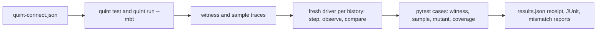

# Model-based testing for Python under pytest

[Quint](https://quint.sh) generates histories from your specification;
pytest-quint-connect replays every step against your real Python implementation
and compares the state you read back with the state the model expects.

This is a community Python integration in the spirit of
[Quint Connect](https://github.com/quint-co/quint-connect) (Rust) and
[Quint's model-based testing guide](https://quint.sh/docs/model-based-testing).
It is not an official Quint project and is not endorsed by its maintainers.

**Why it matters now:** coding agents change code faster than anyone can review it.
Write your high-level rules once as a small Quint model you can test in the abstract;
pytest-quint-connect connects your implementation to it and replays the model's
histories on every run. Every change, by a person or an agent, is checked against
the rules, not against tests the same change may have rewritten.

[Why use it](../docs/why.md){ .md-button .md-button--primary }
[Tutorial: your first contract](../docs/tutorial.md){ .md-button }
[Run it in CI](../docs/ci.md){ .md-button }

## Start

Install the plugin, plus Node.js 22+ with npm. On first use the plugin installs
its locked Quint 0.33.1 into a per-user cache; pass `--quint PATH` or set `QUINT`
to use your own.

```bash
pip install "pytest-quint-connect @ git+https://github.com/gigaverse-app/pytest-quint-connect"
pytest-quint-connect codegen quint-connect.json -o lru_cache_driver.py
```

Declare the contract in a test module, subclass the generated driver base in
`conftest.py`, and run:

```python
from pytest_quint_connect import quint_contract

test_cache = quint_contract("quint-connect.json", driver="cache_driver")
```

```bash
pytest --quint-require-complete
```

## What a contract run does



- **Real pytest cases.** Each witness, sample, mutant and the coverage check is a
  parametrized case: selectable with `-k`, listed by `--collect-only`, reported in JUnit.
- **Fresh Quint, every run.** Traces are regenerated from the model with the
  manifest's seed and bounds. A Quint failure is a setup error, never a pass.
- **Mutation controls.** A mutant passes only when some history produces an
  observed-state mismatch; an exception is not detection.
- **Actionable failures.** A mismatch names the trace, state, action and a
  field-level difference, with a command that replays that exact trace.

| To | Read |
| --- | --- |
| See the benefits, with real output | [Why pytest-quint-connect](../docs/why.md) |
| Build a contract step by step | [Tutorial](../docs/tutorial.md) |
| Make it a required CI check | [Run contracts in CI](../docs/ci.md) |
| Write a manifest | [Contract manifest](../docs/manifest.md) |
| Write a driver and choose a step convention | [Drivers](../docs/drivers.md) |
| Know what a passing run does and does not prove | [What a passing run shows](../docs/limits.md) |
| Configure options and read the receipt | [Reference](../docs/reference.md) |
| Set it up with a coding agent | [Agent skill](../skills/pytest-quint-connect/SKILL.md) |
