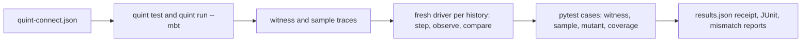

# Model-based testing for Python under pytest

Write the rules of a stateful API once, as a small [Quint](https://quint.sh) model.
pytest-quint-connect replays the histories Quint generates from it against your real
code, and fails when the code disagrees.

## Set it up with your coding agent

Paste this into Claude Code, Codex, Cursor or another coding agent, in your repository:

```text
Add pytest-quint-connect to this repository. Fetch https://pytest-quint-connect.readthedocs.io/en/latest/agent-setup.md and follow it.
```

The agent picks one part of your code that keeps state, writes its rules down as a
short model, connects the model to the code, adds deliberate bugs the check must
catch, adds a CI job, and reports what it verified. **You review the model.** It is
the specification. An agent can write a wrong model, which then checks the wrong
rules, so read it before you merge. The tests themselves run without AI, in CI, on
every change, the split Quint's authors describe in
[Reliable Software in the LLM Era](https://quint.sh/posts/llm_era) and
[Quint Connect](https://quint.sh/posts/quint_connect). The agent follows
[this procedure](../skills/pytest-quint-connect/SKILL.md); to do it by hand, follow the
[tutorial](../docs/tutorial.md).

## In plain words

- **Model**: a short Quint file that says what your API should do: its operations,
  and what you should be able to read back after each one.
- **History**: a sequence of operations generated from the model, with the expected
  state after each step. Some are scenarios you name; the rest are sampled from a fixed seed.
- **Driver**: a few lines of Python that apply each step to your real code and read
  its state back. It never computes the answer.
- **Mutant**: a deliberately broken version of your code. Every run must catch it,
  which proves the check can fail.

Hand-written tests check the cases someone thought of, and a change can rewrite them
along with the code. A contract checks every generated history against rules kept
apart from the code. So a change by a person or a coding agent is judged against the
rules, not against tests the same change may have edited.

This is a community Python integration in the spirit of
[Quint Connect](https://github.com/quint-co/quint-connect) (Rust) and
[Quint's model-based testing guide](https://quint.sh/docs/model-based-testing).
It is not an official Quint project and is not endorsed by its maintainers.

[Why use it](../docs/why.md){ .md-button .md-button--primary }
[Tutorial: your first contract](../docs/tutorial.md){ .md-button }
[Run it in CI](../docs/ci.md){ .md-button }

## Start by hand

Install the plugin, plus Node.js 22+ with npm. On first use the plugin installs
its locked Quint 0.33.1 into a per-user cache; pass `--quint PATH` or set `QUINT`
to use your own.

```bash
pip install pytest-quint-connect
pytest-quint-connect codegen quint-connect.json  # writes lru_cache_driver.py
```

Declare the contract in a test module, subclass the generated driver base in
`conftest.py`, and run:

```python
from pytest_quint_connect import quint_contract

test_cache = quint_contract("quint-connect.json", driver="cache_driver")
```

```bash
pytest --quint-require-complete
```

## What a contract run does



- **Real pytest cases.** Each witness, sample, mutant and the coverage check is a
  parametrized case: selectable with `-k`, listed by `--collect-only`, reported in JUnit.
- **Fresh Quint, every run.** Traces are regenerated from the model with the
  manifest's seed and bounds. A Quint failure is a setup error, never a pass.
- **Mutation controls.** A mutant passes only when some history produces an
  observed-state mismatch; an exception is not detection.
- **Actionable failures.** A mismatch names the trace, state, action and a
  field-level difference, with a command that replays that exact trace.

| To | Read |
| --- | --- |
| See the benefits, with real output | [Why pytest-quint-connect](../docs/why.md) |
| Build a contract step by step | [Tutorial](../docs/tutorial.md) |
| Make it a required CI check | [Run contracts in CI](../docs/ci.md) |
| Write a manifest | [Contract manifest](../docs/manifest.md) |
| Write a driver and choose a step convention | [Drivers](../docs/drivers.md) |
| Know what a passing run does and does not prove | [What a passing run shows](../docs/limits.md) |
| Configure options and read the receipt | [Reference](../docs/reference.md) |
| Set it up with a coding agent | [Agent skill](../skills/pytest-quint-connect/SKILL.md) |
